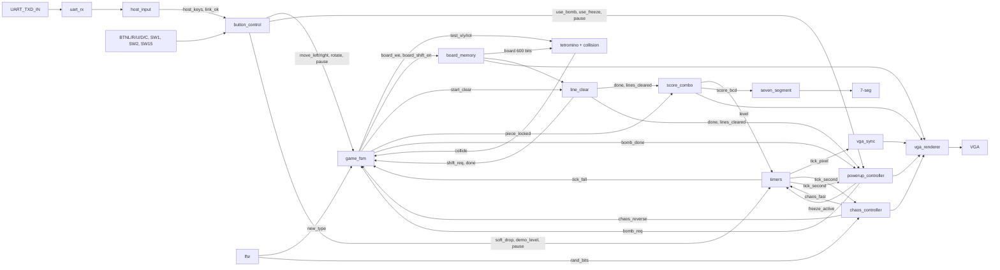

# Architecture — CHAOTETRIS

Ports: [INTERFACES.md](INTERFACES.md) · input path: [input-controller.md](input-controller.md).
Values marked PROPOSED are open in issue #43.

## Clock, reset, enables
- **Clock:** one 100 MHz `clk`. `timers` makes 1-cycle enables: `tick_pixel` (every 4 clocks → 25 MHz VGA,
  never gated), `tick_fall` (gravity; speed from `level`, faster with `soft_drop`, ×2 with `chaos_fast`)
  and `tick_second` (game seconds; faster when SW2 demo timer is ON).
- **Reset:** `tetris_top` turns `CPU_RESETN` (active-low) OR `SW[0]` into synchronous active-high `rst`.
  Reset has priority over everything.

## Hierarchy (`tetris_top`)
New here? The plain-words version of this page is [GETTING-STARTED.md](GETTING-STARTED.md).
Which modules are finished: [rtl/README.md](../rtl/README.md).



Text version (same content):
```
UART_TXD_IN → uart_rx → host_input ─┐
BTNL/R/U/D/C, SW1, SW2, SW15 ───────┴→ button_control ─→ game_fsm, powerup_controller, timers
timers ─ tick_pixel → vga_sync → vga_renderer → VGA
       ─ tick_fall, tick_second → game_fsm, chaos_controller, powerup_controller
game_fsm ⇄ tetromino + collision (test position)        lfsr → game_fsm (new piece), chaos_controller (rand_bits)
game_fsm → board_memory (board_we / board_shift_en)     line_clear ⇄ game_fsm (start_clear / shift_req / done)
line_clear.done → score_combo → seven_segment, vga_renderer, timers (level)
                → powerup_controller (charges)
chaos_controller → game_fsm (chaos_reverse), timers (chaos_fast), vga_renderer
powerup_controller → game_fsm (bomb_req), timers (freeze_active), vga_renderer
```

## Game FSM
`S_RESET → S_SPAWN → S_FALL → S_LOCK → S_CLEAR → S_SPAWN …` · blocked spawn → `S_GAME_OVER` ·
`S_FALL → S_BOMB → S_FALL` when a bomb is served. How a game starts after reset is PROPOSED (#43).

## Who changes the board
- **Only `game_fsm` writes `board_memory`.** Lock = write the 4 piece cells; bomb = write 0 into the
  3×3 locked cells around the active piece anchor, one cell per clock, skipping cells outside the board
  (the active piece is never part of `board`, so it is never removed); row clear = `board_shift_en`.
- `line_clear` only finds full rows and sends `shift_req`; `game_fsm` forwards it as `board_shift_en`.
- `powerup_controller` and `chaos_controller` only send requests/status (`bomb_req`, `freeze_active`,
  `chaos_reverse`, `chaos_fast`). Chaos "reversed controls" is done in `game_fsm` by swapping
  `move_left` / `move_right`; the input layer does not know the game state.

## Request priority (highest first)
1. Reset (`CPU_RESETN`, SW0).
2. Pause (SW15) — see below.
3. Finish work already started: LOCK, CLEAR, an active bomb.
4. `bomb_req`, served only in `S_FALL` at a safe update boundary (no move/rotate in the same cycle);
   `bomb_req` stays high until `bomb_done`.
5. Movement: `rotate`, `move_left` / `move_right` (swapped while `chaos_reverse`), then `tick_fall`.
Freeze never blocks movement, rotation or soft drop; it only stops automatic falling (`tick_fall` off).

## Pause (decided)
- SW15 = pause (ON paused, OFF running). `button_control` synchronizes + debounces it → `pause_level`.
- Pause gates game enables only: `tick_fall`, `tick_second` (so the chaos 30 s countdown, the chaos 5 s
  effect and the freeze 5 s timer stop too). **Never** `clk`, `tick_pixel` or VGA.
- `game_fsm` pauses only in `S_FALL`; LOCK / CLEAR / bomb finish first.
- While paused, all action pulses (move, rotate, bomb, freeze) are ignored and not queued.
- Fall is blocked when paused OR `freeze_active`; freeze and chaos timers count only when not paused.
- SW0 reset has priority. SW15 ON right after reset = the game starts paused.
- The renderer shows **"PAUSED - SW15 OFF to resume"**.

## Display
- VGA: board, active + next piece, score, level, combo, charges, selected power-up (SW1), chaos countdown,
  active effect + its timer, PAUSED and GAME OVER overlays.
- 7-segment: score. LEDs: power-up / chaos status, LED15 = host link (mapping PROPOSED, #43).

For the report: redraw this diagram as `docs/diagrams/architecture.drawio` + `.svg` and link it here.
