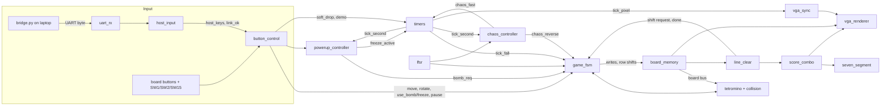

# Getting started — read this first

This page is for every teammate. It explains what we are building, how the pieces fit together,
the words we use, and how to do your first task. Install the tools with [TOOLS.md](TOOLS.md).
The team rules are in [AGENTS.md](../AGENTS.md) and the step-by-step issue → branch → PR workflow is in [CONTRIBUTING.md](../CONTRIBUTING.md) (Thai).

## 1. CHAOTETRIS in one minute
- A falling-block puzzle game built **only from digital logic** (Verilog) on the Nexys A7-100T FPGA board.
  There is no CPU and no software on the board. The picture goes to a VGA monitor (640×480).
- The core game: 7 piece types, a 10×20 board, move / rotate / soft drop, collision, line clear, score
  and a level that gets faster.
- Our extra features (the reason the project is called CHAOTETRIS):
  - **Power-up charges:** every 5 cleared lines give 1 charge.
  - **BOMB:** clears the locked cells in a 3×3 area around the falling piece.
  - **FREEZE:** stops automatic falling for 5 s (you can still move and rotate).
  - **CHAOS event:** every 30 s, for 5 s, either left/right are swapped or pieces fall twice as fast.
  - **COMBO:** clearing lines with several pieces in a row gives a bonus.
  - **Demo timer (SW2):** makes the chaos/freeze timers short so we can show them quickly at the demo.
- How to play: a laptop keyboard or game controller through `scripts/host/bridge.py` (it sends the held
  keys to the board over the USB cable), or the board buttons as a backup. Controls: [README](../README.md#controls).

## 2. How the hardware fits together
Arrows show who sends a signal to whom. Port lists are in [INTERFACES.md](INTERFACES.md); more detail
(priorities, pause rules) is in [ARCHITECTURE.md](ARCHITECTURE.md).

What each module does, in plain words. **Current status of every module is in [rtl/README.md](../rtl/README.md)**
(stub → sim-pass → board-pass). The issue number is where the work and the latest handoff live.

| Module | Owner | What it does | Issue |
|---|---|---|---|
| `timers` | Teerawit | Makes the "ticks": 25 MHz pixel tick for VGA, the gravity tick (faster with level, soft drop, chaos; stopped by freeze or pause) and a 1-second tick for game timers. | #19 |
| `uart_rx` | Korat | Receives one byte from the laptop over the USB-UART line (115200 baud). | #47 |
| `host_input` | Korat | Keeps the 6 held keys from the latest valid byte; releases them all if nothing arrives for 250 ms. | #47 |
| `button_control` | Korat | Cleans the board buttons and switches, mixes them with the laptop keys, and turns them into one-clock actions (with left/right auto-repeat). | #18 |
| `seven_segment` | Pholawath | Shows the score on the 8-digit 7-segment display. | #10 |
| `vga_sync` | Nassasi | Counts pixels and lines and makes the VGA sync signals. | #8 |
| `vga_renderer` | Nassasi | Decides the colour of every pixel: board, piece, score, effects, PAUSED / GAME OVER. | #9 |
| `tetromino` | Korat | A table: piece type + rotation → which 4 cells it covers. | #12 |
| `collision` | Korat | Says whether a piece at a test position would hit a wall, the floor or a locked cell. | #13 |
| `board_memory` | Korat | Stores the 10×20 board (3 bits per cell) and shows all of it on one 600-bit bus. | #15 |
| `line_clear` | Korat | Finds full rows and asks `game_fsm` to remove them. | #17 |
| `game_fsm` | Teerawit | The game "brain": spawn, fall, lock, clear, bomb, game over. The **only** module that changes the board. | #16 |
| `lfsr` | Teerawit | Pseudo-random numbers: next piece type and the chaos event. | #14 |
| `chaos_controller` | Teerawit | 30 s countdown, then one chaos event for 5 s. | #45 |
| `powerup_controller` | Pornnapat | Counts charges, handles bomb / freeze requests and the 5 s freeze timer. | #46 |
| `score_combo` | Pholawath | Score (BCD), lines, level and combo. | #11 |
| `tetris_top` | Pholawath | Connects every module to each other and to the board pins. | #20, #21 |
| `bridge.py` (laptop) | Korat | Reads keyboard / controller and sends the byte. | #48 |

## 3. Words we use
| Word | Meaning |
|---|---|
| **clk** | The one 100 MHz clock. Every register changes only on its rising edge. |
| **tick / clock enable** | A signal that is 1 for exactly one clock now and then (e.g. every 4 clocks). We use ticks to do things slower instead of making a slower clock (AGENTS §4). |
| **pulse** | A signal that is 1 for exactly one clock, e.g. `rotate` when a key is pressed. |
| **level** | A signal that stays at its value as long as the condition holds, e.g. `soft_drop` while the key is held. |
| **synchronous reset** | `rst` is checked only at the clock edge; when 1, registers go to their start value. |
| **latch** | A memory element created by accident when an `always @*` block does not assign a signal in every case. We avoid it by giving default values first. |
| **synchronizer** | Two flip-flops in a row for a signal from outside the chip (button, UART). It avoids random wrong values (metastability). |
| **debounce** | A real button "bounces" between 0 and 1 for a few ms. Debounce waits until the value is stable before accepting it. |
| **edge detect** | Compare a signal with its value one clock ago; `now & ~before` is a one-clock pulse when it goes 0 → 1. |
| **auto-repeat** | Holding left/right moves once, waits 200 ms, then moves every 80 ms. |
| **FSM** | Finite state machine: a register holding the current state (`S_FALL`, `S_LOCK`, …) and rules for the next one. |
| **LFSR** | A shift register with XOR feedback that walks through a long pseudo-random sequence. |
| **BCD** | Each decimal digit stored in its own 4 bits, so the 7-segment and VGA can show digits easily. |
| **UART 8N1** | Serial line: a 0 start bit, 8 data bits (lowest bit first), a 1 stop bit. Idle line = 1. |
| **heartbeat / timeout** | The laptop resends the keys every 50 ms; if the board hears nothing for 250 ms it releases all keys. |
| **stub** | A module with the correct ports but outputs tied to 0. It lets the whole design compile before the real logic exists. |
| **testbench (tb)** | Simulation-only Verilog that drives inputs and checks outputs with `` `CHECK ``. It prints `TB_PASS` or `TB_FAIL`. |
| **mutation test** | Break the RTL on purpose (one line) and confirm the tb fails. If it still passes, the tb is missing a check. |
| **VCD / waveform** | A file with every signal's value over time (`--dump`), viewed in GTKWave. |

## 4. Your first task, step by step
1. **Pick your issue.** GitHub → Issues → filter by your name. Start with your P1 module.
2. **Read the issue thread**, especially the latest *Handoff* comment (AGENTS §11).
3. **Read your module in [INTERFACES.md](INTERFACES.md)** and the modules you connect to. Ports are a contract:
   do not change them alone (see FAQ).
4. **Open the stub** `rtl/<area>/<module>.v`. The header comment lists every port.
5. **Write the testbench first** in `tb/<area>/tb_<module>.v`. Copy the style of a finished one:
   - `tb/game/tb_board_memory.v`: a clocked module with a reference model.
   - `tb/io/tb_uart_rx.v`: a task that drives an input bit by bit.
   - `tb/game/tb_tetromino.v`: a combinational module checked two independent ways.
   - Use the cases in your issue and in [TESTING.md](TESTING.md). Run it: it should **fail** on the stub.
6. **Write the RTL** following AGENTS §4 (one clock, `<=` in `always @(posedge clk)`, defaults in `always @*`).
7. **Run** `bash scripts/sim/run_tb.sh tb_<module>` until `TB_PASS`, then `bash scripts/sim/run_all.sh` and
   `python scripts/ci/check_layout.py` ([TOOLS.md](TOOLS.md)).
8. **Update docs:**
   - your row in [rtl/README.md](../rtl/README.md) (stub → sim-pass)
   - your row in [TESTING.md](TESTING.md)
   - INTERFACES.md only if a port or parameter changed
9. **Open a PR** with the template, add a waveform screenshot, wait for CI, tick the checklist, merge
   with *Create a merge commit*, then add your PR to [CONTRIBUTIONS.md](CONTRIBUTIONS.md).

## 5. Where is…?
| I want to know… | Open |
|---|---|
| the ports of a module | [INTERFACES.md](INTERFACES.md) |
| who has priority (reset, pause, bomb…) and the pause rules | [ARCHITECTURE.md](ARCHITECTURE.md) |
| how the laptop input works (byte format, keys) | [input-controller.md](input-controller.md) |
| which tests to write / what is already tested | [TESTING.md](TESTING.md) |
| which modules are done | [rtl/README.md](../rtl/README.md) |
| shared constants (timer lengths, states, piece codes) | `rtl/include/tetris_defs.vh` |
| rules that are not decided yet | issue #43 |
| how to install tools, run tests, read waveforms | [TOOLS.md](TOOLS.md) |
| how to run the laptop bridge | [scripts/host/README.md](../scripts/host/README.md) (Thai) |
| where to put a file | AGENTS §7 |

## 6. FAQ
- **Can I change a port?** Only together with INTERFACES.md in the same PR, and tag the people whose modules
  connect to it (AGENTS §5). Ask in the issue first.
- **A value says "PROPOSED — see issue #43".** The port exists but the rule is not decided. Build it with
  the proposed value as a parameter or constant so it is easy to change later.
- **My test fails and I don't know why.** Run with `--dump` and open the waveform ([TOOLS.md](TOOLS.md#4-read-a-waveform-gtkwave)).
  Look at the first `CHECK FAILED` time in the log and go to that time in GTKWave.
- **CI is red.** Click *Details* on the PR. `layout` = file name/place, `lint` = Verilog warning/error,
  `sim` = a testbench failed (download the `sim-logs` artifact).
- **Can I use AI?** Yes. You must understand every line, add the `Assisted-by:` trailer and tick the AI box in the PR (AGENTS §10).
- **I don't have the board.** Everything up to sim-pass needs only a PC. Board tests start in P2.
- **Someone else's module blocks me.** Use the stub ports and drive them from your testbench. Ask in their issue.
